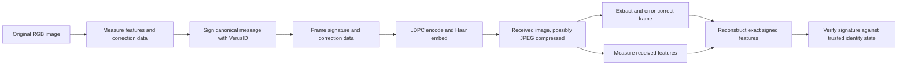

# Vatermark experimental image authentication profiles

This implementation follows the architecture of
[Semi-Fragile Image Authentication based on CFD and 3-Bit Quantization
(arXiv:1608.02291)](https://arxiv.org/abs/1608.02291): smooth image-derived features,
reconcile their quantized values with public helper data, digitally sign them,
and carry the signature/helpers in a Haar watermark protected by LDPC coding.
It is a specified Rust prototype, **not a reproduction of the authors' software**.
Color anchors, quantization conventions, Verus integration, framing, the LDPC
matrix, and carrier shuffling are explicit implementation choices.

The engine's separate legacy DFT–DCT byte-watermark functions are based on
[Hybrid blind robust image watermarking technique based on DFT-DCT and Arnold
transform (arXiv:1911.00753)](https://arxiv.org/abs/1911.00753). They are not the
carrier used by the authentication profiles below. See the
[research citations and licensing distinction](README.md#research-basis): the
linked papers are not bundled or relicensed as Vatermark code.

Two envelope profiles are implemented, both using Verus's standard signing prefix:

| Profile | Application message | Use |
| --- | --- | --- |
| **`0x31`** | Original binary message, including the signer identity | Existing CLI signing and verification |
| **`0x41`** | UTF-8 text committing to a canonical image record, prepared before choosing a signer | New web/mobile signing and verification |

Profile `0x31` keeps its original meaning and remains verifiable. Profile `0x41`
uses the same features, helper data, `VA` frame, LDPC matrix, carrier seed, and
90/110-byte compact envelope. Only the application-message construction changes.
Earlier profiles `0x11` and `0x21` remain unsupported. See the
[web-app brief](WEB_APP_BRIEF.md) and [Rust worker protocol](engine/WORKER.md) for
the prepare → wallet approval → finalize flow.

## Flow and capacity



There is no attempt to invert or remove the watermark. Reconstruction must tolerate
both embedding changes and allowed image-processing changes. Verification needs
the received image plus trusted identity state, but no original image or secret
watermark key. An embedded identity ID locates verification authority; it does
not supply its own trust proof.

| Information | Default system | Explicit system |
| --- | ---: | ---: |
| Compact signature envelope | 90 bytes | 110 bytes |
| Feature-correction helper | 384 bytes | 384 bytes |
| Authentication data | **474 bytes** | **494 bytes** |
| Frame header | 4 bytes | 4 bytes |
| Zero padding | 30 bytes | 10 bytes |
| CRC32 | 4 bytes | 4 bytes |
| LDPC information block | **512 bytes** | **512 bytes** |
| Encoded watermark | **8,192 bits** | **8,192 bits** |

Images may have any aspect ratio or odd dimensions. Each dimension must be at
least **32**, so every cell in the feature grid contains pixels. Watermark
capacity imposes the additional condition:

```text
transform_width  = 8 × floor(width / 8)
transform_height = 8 × floor(height / 8)
carrier_count    = 2 × floor(width / 8) × floor(height / 8)
carrier_count >= 8,192
```

This requires at least **262,144 pixels within complete 8×8 blocks**, without
imposing a square shape or a 512-pixel minimum on either axis. A 512×512 or
1024×256 image provides exactly 8,192 selected coefficients; 640×480 and 641×481
each provide 9,600. Additional coefficients repeat coded bits. A 511×512 image
provides only 8,064 and is rejected.

The transform covers the top-left `transform_width × transform_height` rectangle.
The remaining zero to seven rightmost columns and bottom rows are preserved
verbatim during embedding. Features are measured over the **whole native image**,
including these edge pixels. Output dimensions are unchanged, with no resizing
or padding. Native dimensions are signed, so resizing after signing is outside
this profile. Passing the capacity check does not guarantee compression tolerance
for every image or aspect ratio; the signing flow also verifies its actual output.

## Image features and helper data

The feature profile is fixed, with no unsigned parameter overrides:

1. Convert RGB to luminance using `0.299 R + 0.587 G + 0.114 B`, in 0–255 units.
2. Smooth horizontally and vertically with the normalized kernel
   `[1, 8, 28, 56, 70, 56, 28, 8, 1] / 256`. This fixed Gaussian approximation has
   variance 2 pixels²; edge samples are clamped to the nearest image coordinate.
3. Compute central differences `(right - left) / 2`, `(down - up) / 2`, and their
   Euclidean magnitude. Average the magnitude over a 32×32 grid of cells.
   Cell boundaries are `floor(cell_index * dimension / 32)`; all pixels are covered.
4. Keep **976** distributed gradient cells. Sample `i`, starting at zero, uses
   row-major cell `floor((2i + 1) * 1024 / (2 * 976))`.
5. Append **48 color/DC anchors**: split the original RGB image into a 4×4 grid,
   calculate mean R, G, B in each row-major cell, and divide each mean by **8**.
   This retains some brightness and color information lost by gradient magnitudes.

The result is 1,024 nonnegative values. Quantize each with **Δ = 1**:

```text
q = floor(value / Δ)
upper_half = fractional_part(value / Δ) >= 0.5
helper triple = two bits of (q mod 4), then one upper_half bit
```

Triples are packed consecutively, most significant bit first, without padding:
1,024 × 3 bits = **384 bytes**. The signed quantized vector is 1,024 unsigned
16-bit values serialized little-endian, **2,048 bytes**; that vector is recomputed
during verification and is not embedded.

For each received measurement, compatible half-bin centers are 4Δ apart. Recovery
selects the nearest center consistent with the helper bits and requires distance
at most 1.25Δ. Because the original measurement is at most Δ/4 from that center,
**every feature is recovered exactly when its change is at most Δ**. For color
anchors, one step corresponds to eight RGB mean levels. Larger changes can either
fail reconciliation or produce a different vector; successful reconstruction is
not itself authentication. The signature must verify.

This uses explicit zero-based bins and a bounded-distance decoder instead of
copying the paper's inconsistent one-based quantization equations. The helper
bytes are public correction information, not an encryption key. Both helper and
features are included in the signed message.

## Canonical signed messages

### Profile `0x31`: original binary message

All fields below are concatenated without padding or length prefixes. Integers
are little-endian; floating-point values are IEEE-754 binary64 little-endian.

| Order | Field | Size |
| ---: | --- | ---: |
| 1 | ASCII `Vatermark/image-auth/v1`, followed by one NUL byte | 24 bytes |
| 2 | Envelope version/type, flags, raw identity ID, optional raw system ID | 22 or 42 bytes |
| 3 | Image width, then height, each `u32` | 8 bytes |
| 4 | Feature Δ=1.0, color scale=8.0, Haar step=32.0 | 24 bytes |
| 5 | Feature helper bytes | 384 bytes |
| 6 | Quantized feature vector, each `u16` | 2,048 bytes |
| | **Total application message** | **2,510 or 2,530 bytes** |

The envelope's height and signature bytes are excluded from this application
message. Height is authenticated by the native Verus digest. The original CLI
signing path permits a selected daemon to choose its final height atomically;
the web app does not use this daemon adapter.

### Profile `0x41`: mobile UTF-8 commitment

Construct canonical record `C` by concatenating the following without padding or
length prefixes. Integers are little-endian and floats are IEEE-754 binary64
little-endian, as in the original profile.

| Order | Field | Size |
| ---: | --- | ---: |
| 1 | ASCII `Vatermark/image-auth/v2`, followed by one NUL byte | 24 bytes |
| 2 | Profile `0x41`, then exact envelope flags | 2 bytes |
| 3 | Resolved raw system ID, including when omitted from the envelope | 20 bytes |
| 4 | Native image width, then height, each `u32` | 8 bytes |
| 5 | Feature Δ=1.0, color scale=8.0, Haar step=32.0 | 24 bytes |
| 6 | Feature helper bytes | 384 bytes |
| 7 | Quantized feature vector, each `u16` | 2,048 bytes |
| | **Total canonical record** | **2,510 bytes** |

The record excludes signer identity, signing height, and signature bytes. This
allows preparation before the mobile user chooses an identity. Define text `S` as:

```text
Vatermark image authentication v2\nsha256:<lowercase hexadecimal SHA256(C)>
```

Here `\n` is one LF byte, not a literal backslash and letter. There is no trailing
newline. The application message `M` for this profile is exactly `UTF8(S)`.
Mobile hashes those raw UTF-8 bytes; its length-prefixed `verifyMessage` helper
must not be substituted for the data-packet hash/signature path.

The web worker prepares flags `0x02` with implicit VRSCTEST. It also verifies
flags `0x03` with an explicit VRSCTEST system ID, and rejects other networks or
systems. Flags are signed, so an explicit-system envelope and an implicit-system
envelope have different commitments even when their resolved system IDs match.
Neither `C`, `S`, nor either hash adds watermark bytes: verification reconstructs
them from the received image and embedded helper. Native signature verification
binds the user's identity and height separately, as shown below.

The independent [canonical vector](engine/tests/fixtures/mobile-profile.json)
checks record bytes, commitment, text hash, and native digest across Rust and the
pinned SDK. Preparation also stores a private exact-pixel source hash for job
consistency; that hash is not the robust descriptor, signed message, or watermark.

### Shared native signature digest

The selected native Verus signature format is version 2, SHA-256 hash type 5,
one compact signature, and no VDXF/bound-hash arrays. Both `0x31` and `0x41`
use the exact standard prefix **`Verus signed data:\n`**: 19 bytes, including
the final LF byte (`0x0A`). For application message `M`, the signed digest is:

```text
SHA256(
    resolved_system_id[20] || signing_height_u32_le || identity_id[20]
    || CompactSize(prefix_length) || UTF8(prefix) || SHA256(M)
)
```

Only the standard Verus prefix is supported; verification does not try alternative
prefixes. The application domains `Vatermark/image-auth/v1\0` and
`Vatermark/image-auth/v2\0` identify their respective content schemas. The domain
version, envelope profile version, and native Verus signature version are separate
version fields. Neither application domain nor the native signature prefix is
stored in the watermark.

Raw IDs use decoded address/`uint160` serialization order, not display-hex order.
The image envelope stores only the 64-byte secp256k1 ECDSA `r || s`. Verification
tries supported recovery IDs and compressed/uncompressed encodings, accepts only
a recovered key authorized by trusted identity state, and can reconstruct the
native 73-byte signature. See [the compact envelope](WATERMARK_FORMAT.md).

The format byte fixes all remaining algorithm choices, including smoothing,
cell selection, packing, carrier order, and LDPC matrix. Changes to encoding or
verification for supported images require a new profile value; keeping only the
three numeric settings unchanged is not enough for compatibility.

The native-size support described above applies to both profiles. The exact
profile selects its message construction; relabeling a `0x31` envelope as `0x41`
cannot produce a valid new signature. Earlier prototype formats remain unsupported.

## Watermark frame and channel

The 512-byte information frame is:

```text
offset 0       "VA"                         2 bytes
offset 2       frame version = 1            1 byte
offset 3       envelope length = 90 / 110   1 byte
offset 4       compact signature envelope  90 / 110 bytes
offset 94/114  feature helper               384 bytes
offset 478/498 zero padding                 30 / 10 bytes
offset 508     CRC32 of bytes 0..507        4 bytes, big-endian
```

The CRC detects accidental channel errors; it is not an authentication check.
Unexpected lengths, versions, reserved flags, and nonzero padding are rejected.

The rate-½ **(8192, 4096) IRA-LDPC** code is systematic. Information bytes become
4,096 bits in MSB-first order, followed by 4,096 parity bits. Three seeded
permutations select three data bits per parity check; adjacent parity bits form
a dual-diagonal accumulator. The graph uses ChaCha8 seeded by
`BLAKE3("vatermark-haar-ira-ldpc-v1\0")`, rejecting permutations with position-wise
overlap. The exact generation procedure and a wire-format test vector are in
[`engine/src/ldpc.rs`](engine/src/ldpc.rs). Decoding uses layered normalized min-sum with normalization 0.8,
bounded soft values, and at most 100 iterations. The paper supplies the code size,
not this matrix or decoder implementation.

The carrier is a three-level orthonormal separable Haar transform of luminance
within the complete-block rectangle defined above. Its dimensions are divisible
by eight even when the full image dimensions are not. Only **LH3 and HL3**
coefficients are modified, leaving LL3 unchanged. Coefficients
are shuffled with ChaCha8 seeded by
`BLAKE3("vatermark-haar-carriers-v1\0")`; coded bits repeat in that order on larger
images. For coefficient `c`, bit `b`, and fixed **γ = 32**:

```text
embedded coefficient = γ * (round(c / γ) + (b == 1 ? 1/4 : -1/4))
```

The inverse transform's luminance difference is added equally to RGB channels,
then rounded and clipped to 0–255. Extraction combines soft distances to the
two quantization lattices across repeated observations, decodes LDPC, and checks
the frame before reconstructing the signed features. Rounding and clipping mean
the original image cannot be recovered exactly from the watermarked image.

## Trust, validation, and limitations

The web app fetches historical signing authority and current identity state
through `https://api.verustest.net`; it runs no daemon or wallet. The Rust worker
receives only validated historical identity state from the server. It checks the
signature against keys authorized at the signature's own height. A later key
rotation does not replace that authority. The normal verified result additionally
requires an active current identity; current revocation is reported separately
from a valid historical image signature.

Only threshold-one identities and supported primary key addresses are handled.
The web MVP accepts only VRSCTEST and rejects identities whose recorded `systemid`
differs from VRSCTEST. The payload contains no chain proof. Chain-service failures
or unavailable signing heights are distinguished from invalid authentication.

The development `auth-demo` CLI creates a local signing fixture using profile
`0x31`. Its separately supplied identity JSON is trusted input, not evidence of an
on-chain identity; it must not be accepted from an untrusted image sender as proof
of identity. The optional CLI/node adapter remains a separate development path.
Offline identity files cannot discover later revocation or signing-key updates.

All chain-policy checks depend on the configured source of chain state. The
watermark cannot establish chain consensus, prove when the photo was taken, or
prove that its depicted scene is real. The embedded block height is signing
context, not an independently proven timestamp. A real compatible VRSCTEST Mobile
QR/callback/sign/download/verify cycle still requires configured service credentials
and wallet testing; local cryptographic vectors and mocked chain fixtures do not
substitute for that integration test.

Automated tests cover quantization boundaries, bounded reconstruction, frame
integrity, LDPC correction, Haar transport, signature binding, and identity
validation. `auth-test` separately reports JPEG authentication and content changes,
including payload transplantation, so watermark loss is not confused with
successful content binding.

Existing `0x31` regression tests remain in the engine. New `0x41` tests cover
both envelope sizes, the worker prepare/finalize/inspect/verify flow, EXIF
normalization, native-precision alpha handling, profile separation, altered
context, and dimension binding. The structured-image fixture passes 48 JPEG
cases: two envelope sizes × four qualities (90, 80, 75, 60) × three encoder/sampling
paths × two generations. These results are fixture-specific, not a general
compression or security guarantee.

Benchmark reports from earlier prototype domains/seeds do not establish tolerance
for these profiles. The original project's `0x31` photograph benchmark artifacts
are not bundled with this web MVP. Evaluate intended image collections under the
actual signing profile; a successful local fixture does not establish general
compression tolerance or adversarial security.

The feature family has an explicit limitation: a grayscale checkerboard whose
values alternate between **32 and 223** in 16-pixel squares has the same gradient
magnitudes and 4×4 RGB means as its inversion. Both reconstruct the same signed
descriptor, even with the color anchors. A regression test preserves this known
collision. Other edits or deliberately constructed matches may also pass.
Cryptographic signatures protect the descriptor from alteration; they cannot
make that descriptor unique. This is consistent with broader research on
[adversarial collisions in image hashes (arXiv:2011.09473)](https://arxiv.org/abs/2011.09473).

The intended tolerance is same-size JPEG recompression. No guarantee is made for
arbitrary JPEG quality, repeated compression, resizing, cropping, rotation,
filtering, or generative edits. Even untouched embedding can fail on difficult
images; the signing flow verifies the resulting RGB/PNG and returns an error if
it cannot authenticate. This profile should remain experimental until evaluated
on a representative image corpus and against deliberate feature-matching attacks.
