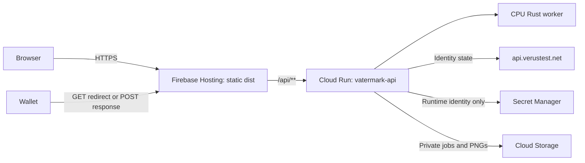

# Vatermark Firebase deployment

Deploy a fork into your own Firebase/Google Cloud project. The checked-in
`.firebaserc` has no project alias and `firebase.json` has no fixed Hosting site;
pass `--project` explicitly to select your project's default site. The app uses
VRSCTEST and reads chain data from `https://api.verustest.net`; it runs no Verus
daemon.

The public upstream deployment is **https://vatermark-9f27a.web.app** in project
`vatermark-9f27a`. The dated release records below document that deployment; its
project and service identifiers are public references, not credentials or fork
defaults.



## Credentials and privacy

Use your own VRSCTEST service identity and its authorized WIF for
`VATERMARK_SERVICE_ID` and `VATERMARK_SERVICE_WIF`. For an existing deployment,
keep its established identity and secret versions unless intentionally rotating
them. Store the values as separate Secret Manager secrets, grant the dedicated Cloud Run runtime service account access, and reference **numeric secret versions** in the revision. Do not provide either value to Cloud Build, Vite, Docker build arguments, Firebase Hosting, or a `VITE_*` variable. Builds need no signing credentials. The runtime account accesses private job objects; the build account does not need job or secret access.

The service identity address is a public protocol identifier: wallets receive it in signed requests so they can verify the service. The WIF remains private. `/api/config` does not return either configured credential, and the Rust child process receives an empty environment. Avoid logging raw wallet responses or configuration.

The Docker context uses a source allowlist; `.env`, local jobs, certificates, Git metadata, local binaries, logs and deployment credentials are excluded. Upload only that allowlisted source archive to Cloud Build; `.dockerignore` alone does not filter an independently constructed source archive. Firebase Hosting uploads only `dist`, which contains browser assets. The container runs as the non-root `node` user.

Cloud Storage must enforce uniform bucket-level access and public access prevention. Do not grant `allUsers` or `allAuthenticatedUsers` access to the bucket or secrets. Cloud Run's HTTP service is publicly invocable for Hosting and wallet callbacks; API handlers still authenticate image access using the job owner's session. No public object URLs or signed bucket URLs are needed.

## Choose a project and provision resources

Create or select a Firebase project with billing enabled and a default Hosting
site. Authenticate the Google Cloud and Firebase CLIs to an account authorized
for that project. Use these shell variables throughout the examples, replacing
`your-project-id` and choosing the actual numeric versions of your secrets:

```sh
FIREBASE_PROJECT_ID=your-project-id
VATERMARK_REGION=us-central1
VATERMARK_REPOSITORY=vatermark
VATERMARK_BUILD_ACCOUNT=vatermark-build
JOB_STORAGE_BUCKET="${FIREBASE_PROJECT_ID}-private-jobs"
VATERMARK_BUILD_SOURCE_BUCKET="${FIREBASE_PROJECT_ID}-build-source"
VATERMARK_PUBLIC_ORIGIN="https://${FIREBASE_PROJECT_ID}.web.app"
VATERMARK_SERVICE_ID_VERSION=1
VATERMARK_SERVICE_WIF_VERSION=1
```

These are deployment-shell variables; they are not Vite configuration. For a
custom domain, set `VATERMARK_PUBLIC_ORIGIN` to its HTTPS origin. If you change
the region or Cloud Run service name, update the matching `/api/**` rewrite in
`firebase.json`; its shared defaults are `us-central1` and `vatermark-api`.
A non-default Hosting site needs an explicit `site` or target in that file.

Before the release commands below, provision these resources in your project:

- Enable Cloud Build, Artifact Registry, Cloud Run, Secret Manager, and Cloud
  Storage APIs, plus Firebase Hosting.
- Create a private Docker Artifact Registry repository named by
  `VATERMARK_REPOSITORY` in `VATERMARK_REGION`.
- Create separate private build-source and job-storage buckets named above.
  Enable uniform bucket-level access and enforce public access prevention on
  both. Limit short-lived job deletion rules to `jobs/`; never delete the
  permanent `gifts/state-v1.json` ledger through a general age rule.
- Create separate build and runtime service accounts. The examples use
  `${VATERMARK_BUILD_ACCOUNT}@${FIREBASE_PROJECT_ID}.iam.gserviceaccount.com` and
  `vatermark-runtime@${FIREBASE_PROJECT_ID}.iam.gserviceaccount.com`.
  Give the build account source-bucket access, Artifact Registry write access,
  and permission to write logs. Give the runtime account object access to the
  private job bucket and access to the two signing secrets. Keep these grants
  separate; the build account must not read signing secrets or private jobs.
- Create `vatermark-service-id` and `vatermark-service-wif` in Secret Manager
  from private local inputs, without putting the values in command arguments,
  source files, or build variables. Record their numeric versions above.
  Grant your deployment account permission to use the service accounts.

No credentials, private inventories, or cloud resources are supplied by a fork.
The commands below reuse the resources you provision; they do not create or
rotate signing keys. Generate and import gifts separately using
[GIFT_CARDS.md](GIFT_CARDS.md), then enable gift issuance. For the existing
upstream deployment, use its established resources and secret versions rather
than the example version numbers.

## Runtime settings

| Setting | Value |
| --- | --- |
| Cloud Run service / region | `vatermark-api` / `us-central1` |
| `NODE_ENV` | `production` |
| `HOST` / `PORT` | `0.0.0.0` / `8080` |
| `PUBLIC_ORIGIN` | Value of `VATERMARK_PUBLIC_ORIGIN` above |
| `VERUS_RPC_URL` | `https://api.verustest.net` |
| `JOB_STORAGE_BUCKET` | Your private job bucket |
| `DATA_DIR` | `/tmp/vatermark` (temporary worker files only) |
| `WORKER_CONCURRENCY` | `1` |
| `WALLET_RESPONSE_MODE` | `redirect` by default; `post` selects POST in new wallet requests |
| `VATERMARK_SERVICE_ID` | `vatermark-service-id` at your chosen numeric secret version |
| `VATERMARK_SERVICE_WIF` | `vatermark-service-wif` at your chosen numeric secret version |
| `GIFTS_ENABLED` | `false` until your private inventory is imported; then `true` |

Hosted mode persists job metadata and image artifacts in the private bucket. Object generation preconditions coordinate state updates between instances; finalization leases allow accepted work to recover after instance replacement. Local development continues to use its filesystem store. Hosted uploads are limited to 30 MiB, and the worker has a 35-second command limit. The Cloud Run revision uses 2 CPUs, 2 GiB memory, 0 minimum and 2 maximum instances, concurrency 8 and a 55-second request timeout. CPU remains allocated while an instance exists, allowing cleanup and accepted work to continue between requests; it still scales to zero when idle.

Firebase forwards only the specially named `__session` cookie to Cloud Run. Hosted job ownership uses this Secure, HttpOnly cookie. API responses and private images use `Cache-Control: no-store`; static hashed assets can be cached. The source image, signed PNG and job record must never be placed in `dist`.

## Wallet callbacks

All new requests use the configured `PUBLIC_ORIGIN` HTTPS origin, independent of the incoming Host header. Both handlers remain enabled:

- Redirect: `GET /api/sign-jobs/{id}/response?i9JzVt59mAVHqjc8WAQJx7bEFAQ4ffuhrC={base64urlResponse}`.
- POST: `POST /api/sign-jobs/{id}/response`, with the serialized response as `application/octet-stream`.

The optional image-details step uses the same transports at
`/api/sign-jobs/{id}/metadata/response`. Its `GenericRequest` carries plaintext
`PartialSignData.message` plus the image-derived `encrypttoaddress`; the wallet
encrypts before publication. A signed callback acknowledges submission; the app
confirms publication separately against the decrypted identity content.

The signed request advertises one callback type, selected by `WALLET_RESPONSE_MODE`. Both validate the response signature, request binding and expiry. A successful browser callback redirects to the public application's landing URL without retaining signature bytes in that landing URL. Callbacks do not require the owner's cookie, since the mobile wallet may use another browser; viewing or downloading the result still requires the original browser session. Local requests created before deployment keep their original callback URL and must be recreated on the deployed website.

## Build and release

`Dockerfile` builds the Rust worker for Linux, installs the locked SDK dependencies with Node 22 and pnpm, runs the server tests against that Linux worker, then builds the browser assets. `cloudbuild.yaml` uses Cloud Build's built-in `$PROJECT_ID` and the `_REGION`, `_REPOSITORY`, and `_BUILD_SERVICE_ACCOUNT` substitutions to select the private image repository and dedicated build account. The build receives no signing secrets and writes logs to Cloud Logging.

Avoid printing the JSON result of `firebase login:list`: the installed CLI includes
OAuth access and refresh tokens in that output. Inspect only selected account or
status fields and never log the full authentication object.

The following commands require Node 22 and authenticated Google Cloud and
Firebase CLIs. They reuse the project, accounts, buckets, repository, and secrets
provisioned above. Keep the selected project explicit in every cloud command.

First install dependencies and create the explicit source archive. The packaging script scans allowlisted files for the currently configured service ID/WIF without printing those values. It reads `.env` for that scan but never includes the file in the archive. Use `--env-file /path/to/private/.env` if the local configuration lives elsewhere.

```sh
corepack pnpm install --frozen-lockfile
VATERMARK_BUILD_DIR="$(mktemp -d "${TMPDIR:-/tmp}/vatermark-build.XXXXXX")"
node scripts/package-cloud-source.mjs "$VATERMARK_BUILD_DIR/source.tgz"

VATERMARK_IMAGE_DIGEST="$(gcloud builds submit "$VATERMARK_BUILD_DIR/source.tgz" \
  --project "$FIREBASE_PROJECT_ID" \
  --region "$VATERMARK_REGION" \
  --config cloudbuild.yaml \
  --substitutions "_REGION=$VATERMARK_REGION,_REPOSITORY=$VATERMARK_REPOSITORY,_BUILD_SERVICE_ACCOUNT=$VATERMARK_BUILD_ACCOUNT" \
  --gcs-source-staging-dir "gs://$VATERMARK_BUILD_SOURCE_BUCKET/releases" \
  --suppress-logs \
  --format='value(results.images[0].digest)')"
```

Continue only after the build succeeds and `VATERMARK_IMAGE_DIGEST` contains a `sha256:` digest. Deploy that exact artifact with runtime secret references; no credential values appear in this command or build inputs:

```sh
gcloud run deploy vatermark-api \
  --project "$FIREBASE_PROJECT_ID" \
  --region "$VATERMARK_REGION" \
  --image "$VATERMARK_REGION-docker.pkg.dev/$FIREBASE_PROJECT_ID/$VATERMARK_REPOSITORY/api@$VATERMARK_IMAGE_DIGEST" \
  --service-account "vatermark-runtime@$FIREBASE_PROJECT_ID.iam.gserviceaccount.com" \
  --port 8080 \
  --cpu 2 \
  --memory 2Gi \
  --min-instances 0 \
  --max-instances 2 \
  --concurrency 8 \
  --timeout 55s \
  --no-cpu-throttling \
  --allow-unauthenticated \
  --set-env-vars "NODE_ENV=production,HOST=0.0.0.0,PUBLIC_ORIGIN=$VATERMARK_PUBLIC_ORIGIN,VERUS_RPC_URL=https://api.verustest.net,JOB_STORAGE_BUCKET=$JOB_STORAGE_BUCKET,DATA_DIR=/tmp/vatermark,WALLET_RESPONSE_MODE=redirect,WORKER_CONCURRENCY=1,MAX_UPLOAD_BYTES=31457280,GIFTS_ENABLED=false" \
  --set-secrets "VATERMARK_SERVICE_ID=vatermark-service-id:$VATERMARK_SERVICE_ID_VERSION,VATERMARK_SERVICE_WIF=vatermark-service-wif:$VATERMARK_SERVICE_WIF_VERSION"
```

Finally build and publish the matching frontend:

```sh
corepack pnpm build
firebase deploy --only hosting --project "$FIREBASE_PROJECT_ID"
```

`firebase.json` rewrites `/api/**` to the named Cloud Run service and pins its current revision. Deploy Cloud Run before Hosting so the release selects the new revision. Pinning also keeps Hosting rollback paired with its API revision. Existing private bucket records survive new container revisions.

After importing your own inventory, set `GIFTS_ENABLED=true` for the hosted
service to expose the claim flow. Preserve the current value when updating an
existing deployment; the example defaults to disabled for a new fork.

The runtime account has object access only to your private job bucket and access to the two named secrets. The build account has source-bucket, Artifact Registry and logging permissions, without access to signing secrets or private jobs. Both buckets enforce public access prevention. Preserve these boundaries when granting future permissions. If credentials are intentionally rotated later, update the numeric versions in the deployment command after validating the replacement identity authority.

Before considering a release complete, check the hosted health/config endpoints, upload/preview ownership, generated callback origin, redirect and POST validation, signed PNG download and verification, secret references, and bucket IAM. Inspect static assets and uploaded build inputs for accidental credential inclusion. A signing test should use an explicitly designated test identity.

Firebase Hosting imposes a 60-second timeout on rewritten requests, even if Cloud Run permits longer. The hosted worker timeout leaves room for request validation and storage. Large or queued jobs can still time out; clients should poll the existing job and retry only as directed rather than creating duplicate signing requests.

References: [Hosting with Cloud Run](https://firebase.google.com/docs/hosting/cloud-run), [Hosting cookies and caching](https://firebase.google.com/docs/hosting/manage-cache), [Cloud Run secrets](https://docs.cloud.google.com/run/docs/configuring/services/secrets), [Cloud Storage generation preconditions](https://cloud.google.com/storage/docs/request-preconditions).


## Upstream deployment history

The dated records below refer only to the public Vatermark deployment. Keep
your own release records when deploying a fork.

### Initial deployment validation — 2026-10-12

Published to `https://vatermark-9f27a.web.app` in project `vatermark-9f27a`, using Cloud Run revision `vatermark-api-00001-4vx`. The image was built by Cloud Build `d608eb41-4d2f-4f5f-a669-12e8b9b5558b` and deployed by immutable digest. Both secret version 1 values were compared with the existing local configuration in memory and matched; no values were printed.

Validation passed: 55 API/configuration/signing/storage tests locally and inside the Linux container, 26 local desktop/mobile browser checks, and desktop/mobile smoke checks on the public website. Live checks covered the real service request signature, canonical callback URL, private PNG preview, foreign-session denial, redirect and POST rejection of invalid responses, unmarked-image verification, and session preservation on browser return. Test image jobs were cancelled afterward. Complete valid wallet-response-to-signed-image flows were tested using designated local test identities; a physical-wallet signing round trip on the deployed site has not been performed.

Both buckets enforce public access prevention and deny anonymous listing. No public project-level IAM bindings exist. Only the runtime service account has explicit access to the two signing secrets; the build account has none. The uploaded source archive and all generated frontend assets were checked against the configured credential values.


### Metadata release — 2026-10-14

Published the optional identity-metadata flow and its plaintext wallet-request
correction to `https://vatermark-9f27a.web.app`.

- Cloud Build: `7c7e8145-dab1-4368-9fb9-ff910742e789`.
- Container digest: `sha256:e3a67c621f5212537b915498ec1d5d9ee3948eaa47855ee5fb7cf97a0968d941`.
- Cloud Run revision: `vatermark-api-00002-8t6`.
- Firebase Hosting version: `a763fcc8bd139c58`, pinned to that API revision.

The release reused the existing runtime configuration and both numeric secret
version 1 references. The secret values matched local configuration in memory;
no service credentials were passed to the build or frontend. The source archive
and browser assets passed the configured credential scan. Both storage buckets
retain public access prevention, and the build account has no direct secret grants.

The Linux container build ran the 88 API/SDK tests and built the frontend. All 40
local desktop/mobile browser tests passed. The new API's health and config checks
report a ready worker with signing and metadata enabled. Native metadata
interoperability was previously checked against a local VRSCTEST daemon using an
unbroadcast identity update. A physical-wallet metadata publication round trip
remains untested.

Live API and desktop/mobile browser smoke checks passed on the Firebase URL.
They covered service request signatures and callback origin, metadata route
validation, private PNG previews and ownership, unmarked-image verification,
responsive layout, signing QR codes, and session preservation after a cross-site
redirect. No browser or console errors occurred. All synthetic image jobs were
cancelled; no chain transactions were broadcast.


### Gift cards and service identity release — 2026-10-14

Published the direct **Get started** gift-card flow without CAPTCHA, using
`vatermark@` to sign website requests. The WIF is unchanged in secret version 1;
the service identity uses `vatermark-service-id:2`. Both values were checked
against local configuration in memory. Credentials were excluded from build
inputs and browser assets.

- Cloud Build: `768443de-875f-4f79-9e6a-720c66bf8960`.
- Container digest: `sha256:d8a45cf2a67190b5403415b526aeb76ecb7ecb7ccf831696e9b65f1419a926c6`.
- Cloud Run revision: `vatermark-api-00003-8js`.
- Hosting version: `231b09b1da1a671c`, pinned to that revision.

Imported **99 cards** into private `gifts/state-v1.json`, excluding the one
already issued locally. Local issuance is disabled; its allocation state is
retained for future exclusion checks. The importer preserves existing hosted
assignments and uses object generation preconditions. The private bucket's
one-day deletion rule now matches only `jobs/`, preserving the permanent gift
ledger. Bucket public access prevention and signing-secret permissions remain
in place. See [GIFT_CARDS.md](GIFT_CARDS.md) for repeatable imports.

Validation: 168 API/tool tests passed locally and inside the Linux container;
48 local desktop/mobile browser tests passed. Live desktop/mobile checks passed
with no console errors, overflow, CAPTCHA requests, or gift claims. A synthetic
image completed the full live flow: request signed by `vatermark@`, locally
constructed Mobile-format response signed by the designated T1 test identity,
valid redirect callback, private PNG download, and independent re-upload
verification. Invalid POST and redirect responses were rejected. The synthetic
job and its images were removed afterward. No chain transactions or gift claims
were performed by the release tests; a physical-wallet round trip was not part
of this automated validation.

This release retained a socket-based network limiter, which caused visitors
through Firebase to share a proxy address and its daily gift allowance. The
15 October release below removes these gift-claim limits.


### Gift claim limits removed — 2026-10-15

Published to `https://vatermark-9f27a.web.app`. Gift allocation no longer checks
network addresses or cooldowns, hourly/daily quotas, request rates, or the former
four-claim concurrency cap. Gift read/claim routes also bypass the common API
rate limiter. The interface no longer advertises a per-network daily limit.
Existing sessions retain their assigned cards; private storage, session ownership,
origin checks, and atomic assignment remain in place. New assignments store no
network hash, while existing version-1 records remain readable.

- Cloud Build: `2c6fd088-7ba6-42cd-b0f3-9a1a9fc84edb`.
- Container digest: `sha256:4a351f975b70d51b00748281bf22c5e6ac545e548eba782bd2eb104f64e913d4`.
- Cloud Run revision: `vatermark-api-00004-hnj`.
- Hosting version: `f931821e9d560adf`, pinned to that revision.

Validation: 169 API/tool tests passed locally and in the Linux build, plus
eight desktop/mobile gift-flow tests. Synthetic tests covered 41 separate
sessions behind the same proxy, repeated reads and claim retries beyond the
former limits, concurrent allocation, and legacy assignment records. Live
desktop/mobile checks passed. Sixteen deliberately invalid claim requests
reached body validation without rate rejection or card allocation. Health,
signing configuration, frontend assets, and Hosting revision pinning passed.

The private hosted ledger was unchanged by release checks: 99 cards, one existing
assignment, and the same object generation. Both signing-secret references are
unchanged (`vatermark-service-id:2`, `vatermark-service-wif:1`); bucket privacy and
secret permissions remain intact. No real gift cards were allocated by tests.


### Interface redesign — 2026-10-16

Published the Apple Human Interface Guidelines-inspired interface to
`https://vatermark-9f27a.web.app`. The redesign adds system typography, a unified
workspace with segmented Sign/Verify controls, automatic dark appearance,
refreshed gift-card and metadata dialogs, and keyboard and enlarged-text support.

- Firebase Hosting version: `bc6aa27bfeb622b1`.
- Existing API revision: `vatermark-api-00004-hnj`.

This frontend-only release reused the existing API revision without a container
build or backend redeployment. The backend template and numeric signing-secret
references are unchanged (`vatermark-service-id:2`, `vatermark-service-wif:1`).
The release made no gift-inventory changes.

Validation: TypeScript and the production build passed, along with 48 local
desktop/mobile browser tests. Visual checks covered 36 mocked states, keyboard
navigation, and enlarged text. All three deployed public assets match the tested
production build and passed the configured credential scan. Live desktop/mobile
checks passed in light and dark appearances, including tabs, the gift dialog,
and private session handling, with no errors or horizontal overflow. Health and
configuration checks confirm signing, metadata, and gifts remain enabled on
VRSCTEST. Live browser checks made no write requests or gift claims.
