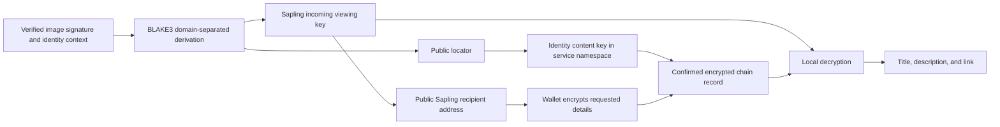

# Optional image details

Vatermark can associate a title, description, and link with a signed image by
storing encrypted data in the signing identity's content. Verification recovers
the decryption capability from the signature already embedded in the image,
looks up the identity content, and displays the decrypted details. The existing
90/110-byte signature envelope and watermark capacity are unchanged.

This implementation was deployed to [Vatermark](https://vatermark-9f27a.web.app)
on **2026-10-14**. A physical wallet has not yet completed the new identity-update
publication flow.
The website needs no Verus daemon. The locally running daemon is only an
interoperability test tool; the website uses the configured chain-data RPC and
the wallet approves and submits the transaction.

## User flow

1. Sign an image using the existing wallet flow and download the completed PNG.
2. Optionally select **Add image details**. Enter one or more of:

   | Field | Maximum length |
   | --- | --- |
   | Title | 120 characters |
   | Description | 400 characters |
   | Website link | 300 characters; HTTP or HTTPS, without embedded credentials |

   The combined JSON representation must fit in **512 UTF-8 bytes**, including
   field names and punctuation. Whitespace is trimmed and empty fields are
   omitted. Multibyte characters use more than one byte.
3. Create the details request, then scan its QR or select **Open wallet for
   details**. Approve the update with the same identity that signed the image.
   The QR and wallet link contain the unencrypted details. The wallet encrypts
   them to the address supplied by Vatermark, then publishes the encrypted data
   through an identity update with a network fee. Use **Enlarge
   QR** on a desktop display if the inline QR is too dense for the phone camera.
4. Return to the originating browser and select **Check publication** if needed.
   An accepted wallet response means the update was submitted. The app reports
   it as published only after checking the corresponding confirmed identity
   content and comparing the decrypted payload with the requested payload's digest.
5. Upload the signed image in Verify mode to read the details from chain data.

The optional step never prevents downloading the signed image. A pending
approval can be cancelled without deleting that image. Once an update has been
submitted to the chain, it cannot be cancelled through this interface. A failed
or expired details request does not undo the completed image signature.

## How the image supplies the decryption capability

The Rust worker derives a Sapling incoming viewing key from the verified native
image signature using BLAKE3 with distinct domain strings. The derivation also
binds the image-signature profile, signing identity, and system identity. It
normalizes the ECDSA S value and omits the reconstructed recovery header, so
equivalent representations of the same signature derive the same capability.

Separate derivation domains produce the incoming viewing key, a valid Sapling
diversifier, and a public locator. The viewing key and diversifier determine a
`zs…` recipient address. **No spending key is generated. Do not send funds to
this address.** The worker exposes the public address and locator, while using
the viewing key internally for decryption.



The wallet's `signdata` flow uses Verus `CDataDescriptor` encryption:
Sapling/Jubjub key agreement, `Zcash_SaplingKDF`, and ChaCha20-Poly1305, with a
fresh ephemeral secret. Vatermark decrypts using the corresponding Rust
Sapling primitives and Verus-compatible serialization; it does not load a wallet
or require Sapling proving parameters. See
[engine/src/metadata_crypto.rs](engine/src/metadata_crypto.rs) and the upstream
[VerusCoin/librustzcash](https://github.com/VerusCoin/librustzcash) implementation.

## Identity update and `signdata`

The server prepares a versioned JSON record without encrypting it:

```json
{
  "schema": "vatermark-image-metadata",
  "version": 1,
  "locator": "<derived public locator>",
  "data": { "title": "Example title" }
}
```

It then creates a service-signed `GenericRequest` containing
`IdentityUpdateRequestDetails` from `verus-typescript-primitives`. That request
appends one content entry to the image signer's identity. It does not request
changes to the identity's primary addresses, authorities, or signing threshold.

The content entry is a `PartialSignData` value in `signDataMap`, using the
primitives' `signdata` path with:

```text
message          = JSON record as a string (unencrypted)
encrypttoaddress = image-derived Sapling address
createmmr        = true
hashtype         = sha256
```

The mobile wallet performs the encryption to `encrypttoaddress` and stores the
encrypted data as on-chain evidence. Vatermark does not add its own encrypted
wrapper. If the wallet uses an RPC server to perform `signdata`, that server
receives the plaintext record. The `signdata` request omits a signing `address`; identity-update transaction
authorization and the signed `GenericResponse` establish the identity's
approval. The native image signature is never included in the `signdata`
message or its public record.

The existing `WALLET_RESPONSE_MODE` selects redirect or POST response delivery.
Both transports validate the request binding, testnet, expected signing
identity, and response signature. The wallet's transaction ID is a receipt;
confirmed chain lookup and decrypted-payload verification are separate checks.
Vatermark records a digest of the requested plaintext payload and compares it
with the decrypted published payload before marking the update as published.

## Lookup and service namespace

The content key is derived using the configured **public service identity**:

```text
getDataKey("vatermark.image.metadata." + locator, serviceIdentityId, VRSCTEST)
```

Wallet requests use the matching fully qualified service namespace. This avoids
ambiguous mainnet/testnet name resolution. A verifier must use the same service
identity namespace to find these records; changing `VATERMARK_SERVICE_ID` changes
the lookup namespace. Its WIF is needed to sign publication requests, but not to
read metadata. Neither the service ID nor the locator is a decryption key.

After authenticating the image, the server derives its capability, looks up
current identity content, and pairs entries with confirmed identity history.
It decrypts the content link, follows its on-chain evidence reference within the
same update transaction, and decrypts the wallet-encrypted data descriptor.
It extracts the JSON record from the native data payload and checks the record's
schema, version, locator, and field limits before displaying it.

The newest matching active record is used. A broken replacement is reported
instead of silently showing an older value. Chain lookups are bounded to 32
matching records and 1,024 identity-history entries; a lookup that exceeds these
limits is unavailable. The implementation accepts the supported on-chain
evidence structure, rather than arbitrary URLs or off-chain downloads.

The UI shows metadata as plain text and permits only HTTP(S) links without
embedded credentials. Unavailable, missing, or invalid metadata is reported
separately from image-signature validity. Optional metadata lookup has a
12-second time budget; if it exceeds that budget, the app returns the image's
signature result with details marked unavailable. Worker saturation and other
infrastructure failures also appear as unavailable details.

## Privacy and trust boundaries

- Anyone with the signed image, or its reconstructed native signature and
  identity context, can derive the viewing key. Sharing the image shares access
  to its details; this is not recipient-specific access control.
- Chain records alone contain public identifiers and ciphertext. They do not
  contain the native image signature, viewing key, or symmetric decryption key.
  The public locator allows records for the same image signature to be linked.
- The website and wallet process plaintext details. The request, QR, and wallet
  link also contain plaintext details, so anyone holding that request can read
  them. If the wallet uses an RPC server for encryption, that server sees the
  plaintext too. Encryption protects the published chain data, not these steps.
- A signer can publish later details. Deleting or replacing current identity
  content cannot erase copies or historical chain records, and cannot revoke a
  viewing capability someone already obtained from the image.
- Encryption provides confidentiality and detects ciphertext changes. Identity
  transaction authorization establishes who published the record. The optional
  text is not part of the previously signed image descriptor.
- The existing image-fingerprint limitations still apply. This feature does not
  make every pixel cryptographically immutable or prove authorship. Chain data
  comes from the configured RPC; the app does not independently validate chain
  inclusion proofs.

## Implementation and testing

- [server/metadata.ts](server/metadata.ts): field validation, plaintext request
  payloads, chain lookup, decryption, and metadata validation.
- [server/metadata-verus.ts](server/metadata-verus.ts): signed identity-update
  requests, wallet responses, content namespace, and chain evidence parsing.
- [engine/src/metadata_crypto.rs](engine/src/metadata_crypto.rs): capability
  derivation and native encrypted data descriptors.
- [src/Metadata.tsx](src/Metadata.tsx): optional second step and verification
  display.

Use the repository's normal TypeScript, Rust, and browser checks. Tests use
isolated fixtures and mocks; encryption interoperability checks can use a local
VRSCTEST daemon. They do not deploy the website or broadcast identity-update
transactions. A real Mobile QR/redirect or POST approval, publication, and
verification round trip remains an explicit manual integration check.
