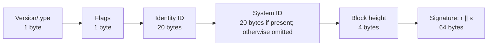

# Vatermark compact Verus image signature envelope

Implemented experimental layout for a **90-byte** signature envelope, or **110
bytes** with an explicit system ID. The authentication encoder carries this
envelope and 384 bytes of image-feature correction data inside a 512-byte frame;
see [AUTHENTICATION.md](AUTHENTICATION.md). The earlier DFT–DCT encoder remains a
separate 48-byte baseline.

## Layout

Fields appear in this order, without padding:

| Field | Bytes | Offset: default system | Offset: explicit system |
| --- | ---: | ---: | ---: |
| Version/type | 1 | 0 | 0 |
| Flags | 1 | 1 | 1 |
| Identity ID | 20 | 2 | 2 |
| Optional system ID | 20 | — | 22 |
| Signing block height | 4 | 22 | 42 |
| ECDSA signature (`r || s`) | 64 | 26 | 46 |
| **Total** | | **90** | **110** |

- **Version/type:** high nibble is the version and low nibble is the type.
  **`0x31`** is the original binary-message profile (version 3, authentication
  type 1). **`0x41`** is the mobile-compatible UTF-8 commitment profile (version 4,
  authentication type 1), used for new web signatures. Both are verified without
  changing their meanings; other profiles, including `0x11` and `0x21`, are rejected.
  The byte selects the complete fixed message and watermark profile.
- **IDs:** raw 20-byte Verus identity/system identifiers, without Base58 text,
  address-prefix bytes, or address checksums. Use the byte order of the decoded
  address payload / Verus `uint160` serialization, not display-hex order.
- **Height:** unsigned 32-bit little-endian; retain the original signing height.
- **Signature:** secp256k1 ECDSA, 32-byte big-endian `r` followed by 32-byte
  big-endian `s`. No DER, Base64, or recovery-header byte.

## Flags and system selection

| Mask | Meaning |
| --- | --- |
| `0x01` | `HAS_SYSTEM_ID`: the optional 20-byte system ID is present. |
| `0x02` | `TESTNET`: resolve identities and systems on testnet. |
| `0xFC` | Reserved; reject nonzero reserved bits in this format version. |

Without `HAS_SYSTEM_ID`, the effective system is **VRSC** when `TESTNET` is clear,
or **VRSCTEST** when it is set. With `HAS_SYSTEM_ID`, use the supplied system ID;
`TESTNET` still determines the network. Do not fall back to another network.

The web MVP supports **VRSCTEST only**. New profile `0x41` signatures use flags
`0x02`, giving a 90-byte envelope. Verification also accepts a 110-byte envelope
with flags `0x03` and an explicit system ID equal to VRSCTEST. Mainnet and other
systems receive an unsupported-network result.

## Verification contract

This compact profile carries **one signature** and requires an identity with a
one-signature authorization threshold. This profile fixes native Verus
signature version **2**, hash type **5 (SHA-256)**, and empty VDXF/bound-hash arrays.
These choices allow reconstruction of the omitted native-envelope fields.

| Envelope profile | Native signature prefix | Use |
| --- | --- | --- |
| `0x31` | `Verus signed data:\n` (19 bytes, including final LF) | Original binary message; existing CLI signing and verification |
| `0x41` | `Verus signed data:\n` (19 bytes, including final LF) | UTF-8 commitment; new web/mobile signing and verification |

Both supported profiles use the same exact native prefix; no fallback is attempted.
The native signature version remains 2, independently of the envelope version.
Profile `0x41` retains the feature algorithm, `VA` frame, Haar channel, and LDPC/carrier
seeds of `0x31`; it changes the application message. Existing `0x31` images remain
verifiable and do not need regeneration. Clients supporting only `0x31` cannot
verify `0x41`. Neither profile accepts the earlier prototype formats.

Look up the identity on the selected system at the signing height and enforce
its validity, revocation state, and signing authority. Recover candidate public
keys from `r`, `s`, and the exact signed digest, checking the supported recovery
IDs and compressed/uncompressed encodings against authorized identity keys.
Reconstruct a native compact signature and require complete Verus verification.

For `0x31`, the binary application message contains the version/type, flags,
identity ID, optional system ID, dimensions, fixed feature/transport settings,
correction data, and reconstructed fingerprint.

For `0x41`, canonical record `C` contains the domain `Vatermark/image-auth/v2\0`,
version/type, flags, the **resolved** system ID, dimensions, settings, correction
data, and reconstructed fingerprint. It excludes identity and height so the user
can choose a signing identity after scanning. The signed UTF-8 text is
`Vatermark image authentication v2\nsha256:<lowercase SHA256(C)>`, with one LF and
no trailing newline. The record, text, and hashes are recomputed rather than embedded.

In both profiles, the native Verus digest independently binds the resolved system
ID, identity ID, and signing height. Exact byte encodings and the native preimage
are specified in [AUTHENTICATION.md](AUTHENTICATION.md). See also the
[web signing flow](WEB_APP_BRIEF.md) and [worker protocol](engine/WORKER.md).

The **90/110-byte totals exclude** image-feature correction data, watermark
framing, checksums, and watermark error-correction redundancy. They assume the
verifier can obtain trusted identity/chain state; no chain proof is embedded.
