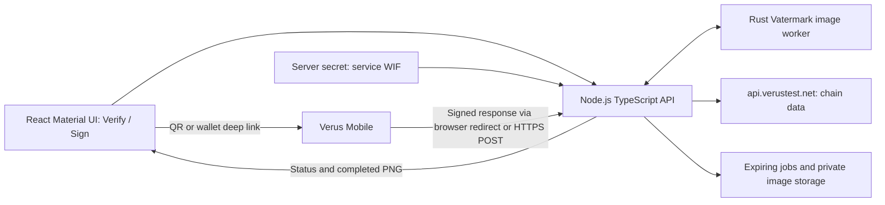

# Vatermark web app implementation brief

Status: implemented MVP specification. See [README.md](README.md) for current
setup and validation limits, and [FIREBASE_DEPLOYMENT.md](FIREBASE_DEPLOYMENT.md)
for deployment records. The interface now follows Apple's Human Interface
Guidelines while retaining Material UI components.

## Product and scope

Build a hosted, responsive application with two modes:

- **Verify:** upload a watermarked image, extract its signing identity, obtain
  the relevant identity state from VRSCTEST, and verify the image signature.
- **Sign:** upload an image, display a QR request for Verus Mobile, receive the
  user's approved identity signature, embed it, and offer the verified PNG.

The initial deployment supports **VRSCTEST only**. Display a persistent Testnet
badge. Mainnet images and images for other systems receive an explicit
unsupported-network result. Do not interpret them using testnet identity data.

Use `https://api.verustest.net` for chain data. Run no local Verus daemon or
wallet. The website holds a server-side WIF controlling its own VRSCTEST service
identity; that identity signs requests. The identity selected in the user's
mobile wallet signs the image. These are separate signatures and roles.

Keep the current experimental authentication limits visible: verification proves
that the reconstructed image descriptor matches an authorized identity signature.
It does not prove authorship, ownership, or that every pixel is unchanged.
See [AUTHENTICATION.md](AUTHENTICATION.md) for the known descriptor collisions.

## Architecture and dependencies



Retain image processing, feature reconstruction, compact signature verification,
and watermark encoding in Rust. Add a TypeScript service for the web API and the
required Verus libraries. Use a bounded Rust worker process with structured IPC;
do not shell-interpolate uploads, filenames, or signatures. The WIF belongs only
to the TypeScript signing service and is never passed to the image worker.

Import these libraries from the official GitHub repositories, not local sibling
paths or unrelated registry packages:

| Library | Git dependency source | Responsibility |
| --- | --- | --- |
| `verusid-ts-client` | `git+https://github.com/VerusCoin/verusid-ts-client.git` | Locally sign requests; verify generic envelopes and identity signatures |
| `verus-typescript-primitives` | `git+https://github.com/VerusCoin/verus-typescript-primitives.git` | VDXF objects, binary parsing, network constants, request/response serialization |
| `verusd-rpc-ts-client` | `git+https://github.com/VerusCoin/verusd-rpc-ts-client.git` | Public chain RPC, historical/current identity lookups, blocks and heights |

Pin compatible full commit SHAs and commit the dependency lockfile. Align direct
and transitive primitives dependencies to the same revision: validation uses
`instanceof`, and duplicate/incompatible class definitions can break it. Check
that selected Git revisions include matching compiled `lib/` or `dist/` files;
these repositories currently have no automatic `prepare` build hook. Require a
clean-install smoke test against the target Mobile build.

Initialize the server-side client as follows:

```ts
import { VerusIdInterface } from "verusid-ts-client";
import { TESTNET_VERUS_CHAINID } from "verus-typescript-primitives";

const verusId = new VerusIdInterface(
  "VRSCTEST", "https://api.verustest.net", { timeout: 15_000 },
);
const rpc = verusId.interface; // VerusdRpcInterface
```

The RPC client posts to the endpoint root; do not invent a `/VRSCTEST` route.
At startup, confirm `getinfo` identifies VRSCTEST, `testnet=true`, and chain ID
`iJhCezBExJHvtyH3fGhNnt2NhU4Ztkf2yq`. The endpoint returned these values and served
a historical `getidentity` query when checked on 2026-10-12. This confirms basic
RPC availability, not a completed mobile-signing integration test.

Required deployment configuration:

| Setting | Purpose |
| --- | --- |
| `WALLET_RESPONSE_MODE` | `redirect` by default for local testing; optional `post` for HTTPS callbacks |
| `PUBLIC_ORIGIN` | Callback origin; HTTP allowed for local redirect mode, HTTPS required for POST |
| `VERUS_RPC_URL` | `https://api.verustest.net`; server-controlled |
| `VATERMARK_SERVICE_ID` | Service's existing VRSCTEST identity i-address |
| `VATERMARK_SERVICE_WIF` | Secret authorized primary signing key |
| Job/storage limits | Upload bytes, decoded pixels, worker concurrency, timeouts and retention |

Inject the WIF through deployment secret storage into the server runtime. Never
include it in browser bundles, QR content, logs, source control, or RPC requests.
Check that it controls an active service identity with `minimumsignatures=1`,
and verify generated requests through the SDK before presenting them. The SDK
signs locally; no remote wallet/signing RPC or private-key import is required.
If the service key is missing or unusable, disable Sign with a configuration
error while keeping Verify available; image verification requires no private key.

## New mobile-compatible signing profile

Preserve verification of existing profile `0x31`. Add profile **`0x41`** for new
web/mobile signatures; do not change what `0x31` means. Reuse the current feature
algorithm, Haar/LDPC channel, `VA` frame, and deterministic seeds.

Mobile hashes UTF-8 strings directly, or hashes a complete serialized
`DataDescriptor`. It does not accept our existing arbitrary binary message as a
raw-byte request. Use one short, deterministic string as the signable object.

Define canonical record `C` by concatenating these fields in order:

| Field | Encoding |
| --- | --- |
| Domain | ASCII `Vatermark/image-auth/v2` followed by one NUL byte |
| Profile and flags | One byte each; `0x41`, then the exact envelope flags |
| Resolved system ID | Raw 20-byte ID, even when omitted from the compact envelope |
| Width and height | Two little-endian `u32` values |
| Feature step, color scale, Haar step | IEEE-754 binary64 little-endian: `1.0`, `8.0`, `32.0` |
| Correction helper | Existing 384 bytes |
| Quantized features | Existing 1,024 little-endian `u16` values |

There is no padding or implicit JSON serialization. Define the exact signing
text `S` as UTF-8 bytes of:

```text
Vatermark image authentication v2\nsha256:<lowercase hex SHA256(C)>
```

Here `\n` denotes **one LF byte**, not two literal characters. There is **no
trailing newline**. This hashes the reconstructible authentication record, not
the original image file or PNG/JPEG bytes. At verification, recover the features
using the embedded helper, rebuild `C` and `S`, and verify that exact message.

Exclude the user's identity and signing height from `C` so the user can select
an identity after scanning. The standard native Verus digest independently binds
identity, system, and height:

```text
SHA256(system_id || height_u32_le || identity_id
       || CompactSize(19) || UTF8("Verus signed data:\n") || SHA256(S))
```

The service knows the network/system before creating the QR. New web signatures
use flags `0x02` (testnet, implicit VRSCTEST), giving a 90-byte envelope. Retain
110-byte parsing and verification when an explicit system ID equals VRSCTEST.
Reject other systems. Empty VDXF/bound-hash extras and one native v2/SHA256 compact
signature remain mandatory.

No extra watermark storage is needed for `C`, `S`, or their hashes. The compact
envelope remains 90/110 bytes, plus 384 helper bytes inside the existing 512-byte
frame, protected by 8,192 encoded bits. Request IDs, timestamps and session expiry
belong to the outer request/job, not `S`.

Add Rust APIs for preparation without a known signer, finalization after receiving
a verified signature, and inspection/verification using supplied trusted identity
state. Do not invent a placeholder identity or use a local test identity for the
web signing flow. The hosted path must not call the current CLI/daemon adapter.

## Sign mode: request, approval and finalization

1. Accept an image and show its preview. Rust validates it and prepares features,
   helper bytes, and `S`. Retain the exact normalized source image and prepared
   data in a private, expiring job. The browser must not supply trusted features.
2. Generate a random 20-byte request identifier represented as a
   `CompactIAddressObject` and create a `GenericRequest` containing
   exactly one `DataPacketRequestOrdinalVDXFObject`. Its `DataPacketRequestDetails`
   uses `FLAG_FOR_USERS_SIGNATURE`, the same identifier as its detail request ID, and
   `signableObjects: [S]`. Omit additional statements: Mobile signs them separately.
3. Include an outer request ID, creation time in Unix seconds, testnet flag,
   `VERUS_MOBILE_GENERIC_REQUEST_HANDLER_ID`, and a `VerifiableSignatureData`
   signature object explicitly identifying the service ID and VRSCTEST system.
   Set its wrapper version to `TYPE_VERUSID_DEFAULT` and `isTestnet=true`.
   Set the outer envelope's testnet flag as well.
4. For local testing, set exactly one browser callback using
   `ResponseURI.fromUriString(callbackUrl, ResponseURI.TYPE_REDIRECT)`. HTTP is
   supported in redirect mode. Optional `WALLET_RESPONSE_MODE=post` instead uses
   `ResponseURI.TYPE_POST` and requires HTTPS. Mobile prefers POST if both are
   supplied, so advertise only the selected transport. Construct the URL from
   `PUBLIC_ORIGIN`, never an arbitrary upload field or untrusted Host header.
5. Call `verusId.signGenericRequest(request, serviceWif)`, then require
   `verifyGenericRequest(signedRequest, undefined, TESTNET_VERUS_CHAINID)` to pass.
   Save the exact serialized request and `signedRequest.getRawDataSha256()`.
6. Render `signedRequest.toWalletDeeplinkUri()` as a QR code and provide an
   **Open wallet** link on phones. Use the full `verus://1/...` URI, not raw
   `toQrString()` output. The short commitment avoids putting image data in the QR.
7. The user chooses a linked VRSCTEST identity, reviews the request, signs, and
   completes delivery in Mobile. The browser polls its job or uses SSE to update.
   Compatible Mobile builds currently require **Enable experimental deeplinks**
   in General wallet settings; explain this beside the QR.
8. After the callback passes all checks below, create the compact envelope from
   the **user's inner signature**, embed it, serialize the PNG, and independently
   verify the actual PNG before making it downloadable. Show the signing identity
   and offer **Download signed image**.

Do not use the service's request signature or the outer response signature as
the embedded image signature. Signing performs no blockchain transaction.

### Callback verification contract

In redirect mode, Mobile opens the callback URL with unpadded base64url
`GenericResponse.toBuffer()` under query key
`GENERIC_RESPONSE_DEEPLINK_VDXF_KEY.vdxfid`. Require exactly one value and
canonical, size-bounded base64url decoding. In POST mode, Mobile sends the same
raw bytes as `application/octet-stream`; read a bounded binary body, not JSON.
Both transports use the same acceptance and signature checks. Use fresh SDK parser instances and
require complete consumption of the input, rejecting trailing or malformed data.
Validate supported envelope and signature-data wrapper versions, signature types,
known flags, and the expected unencrypted layout explicitly; successful generic
signature verification does not perform all of these application schema checks.

Before finalizing a job:

- Require a pending, unexpired job. Verify the signed outer response with
  `verifyGenericResponse(response, undefined, TESTNET_VERUS_CHAINID)`.
- Check testnet/system, outer request ID, hash type SHA256, and
  `response.requestHash.equals(storedRequest.getRawDataSha256())`. Compare byte
  buffers by value, not JavaScript object identity. This uses the
  SDK's default unsigned request hash, matching Mobile's implementation.
- Require exactly the expected `DataResponseOrdinalVDXFObject`, matching its
  detail request ID. Parse `data.objectdata` as `VdxfUniValue` and require one
  `SignatureDataKey.vdxfid` signature entry for `S`.
- Require inner and outer signer IDs/systems to agree. Require native signature
  version 2, hash type 5, a single compact signature, and no extra bound hashes or
  VDXF context. Compare `signatureHash` with the server's `SHA256(UTF8(S))`.
- Resolve historical identity authority at the **inner signature's own height**
  and enforce `minimumsignatures=1`. Do not substitute the outer signature height
  or the latest identity definition. Apply the current identity policy below.

Use this SDK path for the inner signature after structural/hash validation:

```ts
const native = sigData.signatureAsVch.toString("base64");
const info = await verusId.getSignatureInfo(
  sigData.identityID, native, TESTNET_VERUS_CHAINID,
);
const digest = sigData.getIdentityHash({
  version: info.version, hash_type: info.hashtype, height: info.height,
});
const valid = await verusId.verifyHash(
  sigData.identityID, native, digest, undefined, TESTNET_VERUS_CHAINID,
);
```

**Do not use `verifyMessage(S)`**: that API hashes a length-prefixed message,
which differs from Mobile's raw UTF-8 data-packet hashing. Only after successful
verification should Rust import the native signature's height and 64-byte `r || s`.

Accept callbacks atomically. An identical retry after acceptance returns success
without creating another output; conflicting, expired, or cross-job responses
fail. Store a validated response before acknowledging it so finalization can
resume after a worker restart. Recheck expiry/state inside the acceptance
transaction. Regenerating a QR creates a new request and invalidates the old one.

## Verify mode and identity policy

Verify needs only the uploaded image; it does not request a wallet connection,
user login, original image, or signing key. Rust extracts the frame, profile,
identity ID, flags/system, helper and signature, and reconstructs the appropriate
message for `0x31` or `0x41`.

Query `getIdentity(identityID, signingHeight)` through the public RPC client for
the signing authority, and fetch the latest identity state separately. Verify
the native signature against authorized historical primary keys and require the
compact format's one-signature threshold. Pass only server-fetched, validated
identity state to Rust. Match returned IDs/system and ensure the identity record
was effective at the requested height; its update height may legitimately be
earlier. Use current names for display only; the embedded i-address is authoritative.

Policy: require an active identity at signing time and a currently active identity
for the normal verified result. A normal subsequent key rotation must not replace
historical key authority. If the signature was valid historically but the identity
is now revoked, show **Signer revoked** and the historical verification result
separately. SDK generic-envelope verification alone does not enforce this latest
revocation policy; apply it to service and user identities where relevant.

Return distinct states for **Signature verified**, **No supported watermark
recovered**, **Authentication failed**, **Signer revoked**, **Unsupported
network/profile**, and **Could not verify—chain service unavailable**. Extraction
failure does not establish that no watermark ever existed. RPC outages or a
signature height not yet available from the endpoint must not be reported as a
forged image. Treat the external RPC as the configured source of chain state,
not as an independently validated chain proof.

## API and job lifecycle

| Endpoint | Contract |
| --- | --- |
| `POST /api/verify` | Image upload; return signature result, i-address, resolved name, system, height and reason codes |
| `POST /api/sign-jobs` | Image upload; return job ID, QR/deep-link payload and expiry |
| `GET /api/sign-jobs/:id` | Originating browser's job status and completion details |
| `POST /api/sign-jobs/:id/response` | Public wallet callback accepting the signed binary response |
| `GET /api/sign-jobs/:id/response` | Browser callback with base64url response query; validate then 303 to a clean app URL |
| `GET /api/sign-jobs/:id/image` | Authorized download of the completed PNG |
| `DELETE /api/sign-jobs/:id` | Cancel job and schedule private data cleanup |

Use `preparing → awaiting_signature → finalizing → complete`, with `failed`,
`expired`, and `cancelled` terminal states. Persist enough private state to survive
restarts: source image, prepared data, exact request/text, accepted response,
expiry and result location. A callback URL is not authorization to inspect or
download a job: bind those endpoints to the originating browser session. The
callback itself uses signature/request verification, not browser cookies.
Never create or replace an owner cookie on the redirect callback: a cross-site
return can omit `SameSite=Strict` cookies even in the initiating browser. The
clean app page can resume a job only after an owner-authenticated status request;
a different browser receives guidance to return to the original tab. Set
`no-store` and `no-referrer`, and keep response bytes out of the final app URL.
Use the computer's LAN address for a physical phone; redirect does not make
the phone's localhost point to the computer. HTTPS remains the hosted setup.

Start with a 15-minute approval window and short configurable output retention.
Delete uploads, temporary files and expired results automatically; provide
cancellation. Bound upload size, decoded pixels, callback size, processing time,
request rates and worker concurrency. Keep files private and use unguessable
identifiers. No public image gallery or persistent user account is required.

## Interface experience and image handling

Use React with [Material UI](https://mui.com/material-ui/getting-started/) and a
shared theme informed by the [Apple Human Interface Guidelines](https://developer.apple.com/design/human-interface-guidelines/).
Use system typography, clear content hierarchy, automatic light/dark appearance,
accessible contrast and focus states, and responsive controls and dialogs. Present **Verify** and **Sign** as the two primary tabs.
Use a file picker/drop zone, image preview and one clear primary action per step.
Do not expose protocol bytes or SDK terminology in the normal user flow.

Verify results show the identity's readable name and copyable i-address, signature
status, testnet, and an optional details panel for signing height and failure
reason. Explain descriptor-based authentication in a short expandable note.
Signing shows upload/preparation progress, the QR with expiry and wallet help,
approval/finalization progress, then the verified image preview and download.
Provide retry/cancel actions and announce progress/results to assistive technology;
never rely on color alone. Browser preview and processed pixels must agree about
orientation; any orientation normalization must happen before preview and signing.

Preserve the Rust engine's rules: PNG/JPEG input, native dimensions, arbitrary
aspect ratios and odd sizes, each dimension at least 32, and
`2 × floor(width/8) × floor(height/8) >= 8192`. Strip alpha only when every sample
is fully opaque; reject actual transparency with a clear explanation. Preserve
untouched edge strips. Output PNG with no automatic resizing or lossy conversion;
image metadata is not preserved. Reject unsupported formats before creating a QR.

## Delivery and acceptance

1. Specify and test `0x41` byte/text/digest vectors across Rust and the pinned SDKs;
   preserve `0x31` verification. Add Rust prepare/finalize/inspect integration.
2. Implement service-key configuration, public RPC adapter, expiring jobs, signed
   request creation, and strict callback parsing/verification.
3. Implement both interface modes, progress updates and private downloads.
4. Validate deployment over HTTPS with an actual compatible VRSCTEST Mobile build.

Acceptance requires: an end-to-end mobile QR/callback/sign/download/verify cycle;
verification without the service WIF or wallet participation; correct historical
key rotation and revocation behavior; rejected wrong-network, wrong-message,
wrong-job and malformed signatures; safe callback retries/expiry/restarts; clear
RPC-outage states; opaque-alpha and rectangular-image regressions; final PNG
verification; and the existing same-size JPEG authentication tests rerun for the
new profile. Assert that no hosted path invokes a daemon/CLI or transmits the WIF.

Implementation references: [Rust authentication](engine/src/auth.rs),
[compact signatures](engine/src/verus.rs), [payload layout](WATERMARK_FORMAT.md),
[SDK](../verusid-ts-client/src/VerusIdInterface.ts),
[RPC transport](../verusd-rpc-ts-client/src/VerusdRpcInterface.ts),
[Mobile packet signer](../Verus-Mobile/src/utils/deeplink/dataPacket/signDataPacket.js),
[Mobile response binding](../Verus-Mobile/src/utils/deeplink/genericResponse/prepareGenericResponseForSigning.js),
and [Mobile delivery](../Verus-Mobile/src/containers/DeepLink/GenericRequestComplete/GenericRequestComplete.js).
